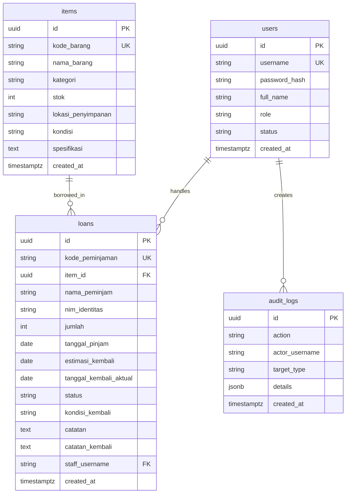

# 🔬 SIMLAB — Laboratory Inventory & Borrowing Management System
### *Sistem Manajemen Inventaris & Peminjaman Laboratorium Terintegrasi*
**Proyek Praktikum / Tugas Pemrograman Semester 5**

[](https://nextjs.org/)
[](https://www.typescriptlang.org/)
[](https://tailwindcss.com/)
[](https://supabase.com/)
[](https://vercel.com/)

Aplikasi web modern, responsif, dan siap produksi yang dirancang khusus untuk manajemen perangkat keras laboratorium institusi, pencatatan transaksi peminjaman mahasiswa, pelacakan keterlambatan (*overdue*), inspeksi kondisi kembali (*maintenance workflow*), serta manajemen akun staf dengan kontrol akses ketat (**Role-Based Access Control / RBAC**).

---

## 📋 Daftar Isi
1. [Ringkasan Fitur & Nilai Tambah](#-ringkasan-fitur--nilai-tambah)
2. [Arsitektur & Tech Stack](#-arsitektur--tech-stack)
3. [Matriks Peran Pengguna (RBAC)](#-matriks-peran-pengguna-rbac)
4. [Data Awal (Seed Data)](#-data-awal-seed-data)
5. [Skema Database & Triggers](#-skema-database--triggers)
6. [Panduan Instalasi & Menjalankan Lokal](#-panduan-instalasi--menjalankan-lokal)
7. [Panduan Konfigurasi Supabase](#-panduan-konfigurasi-supabase)
8. [Panduan Deployment ke Vercel](#-panduan-deployment-ke-vercel)
9. [Struktur Folder Proyek](#-struktur-folder-proyek)
10. [Troubleshooting](#-troubleshooting)

---

## 🚀 Ringkasan Fitur & Nilai Tambah

### 1. Hybrid Storage Engine (Zero Setup Friction)
Aplikasi dilengkapi sistem **Dual Data Engine**:
- **Supabase Cloud Mode**: Jika environment variable `NEXT_PUBLIC_SUPABASE_URL` dan `NEXT_PUBLIC_SUPABASE_ANON_KEY` telah disetel, aplikasi otomatis melakukan query ke PostgreSQL Supabase.
- **Standalone LocalStorage Engine**: Jika kredensial Supabase belum diisi atau sedang offline, aplikasi otomatis beralih ke penyimpanan lokal browser dengan seed data bawaan. Penguji atau dosen dapat langsung menguji seluruh fitur tanpa hambatan konfigurasi awal.

### 2. Modul Lengkap (A s/d F)
- **Modul A — Otentikasi (`/login`)**:
  - Tampilan kartu login modern dengan branding laboratorium.
  - Validasi username dan kata sandi.
  - **1-Click Quick Fill**: Tombol pintas sekali klik untuk akun Demo Admin dan Demo Staff.
- **Modul B — Overview Dashboard (`/dashboard`)**:
  - 4 Kartu Metrik: *Total Jenis Barang, Stok Siap Pakai, Sedang Dipinjam, Total Transaksi*.
  - Visualisasi Distribusi Kategori Barang berbasis progress bar multi-warna.
  - **Banner Peringatan "Perlu Perhatian"**: Otomatis mendeteksi peminjaman yang terlambat (*overdue*) dan barang dengan stok kritis (< 3 unit).
  - Feed aktivitas terbaru & log audit keamanan.
- **Modul C — Inventaris Barang (`/inventory`)**:
  - Pencarian instan (kode, nama, lokasi) dan filter kategori (*Semua, Komputer, Periferal, Multimedia, Display, Jaringan*).
  - Indikator status stok: Hijau (*Tersedia*), Kuning (*Menipis: 1-2 unit*), Merah (*Habis: 0 unit*).
  - Kontrol Admin: Modal Tambah Barang, Modal Edit Barang, dan Modal Konfirmasi Hapus.
  - **Proteksi Hapus**: Sistem otomatis memblokir penghapusan barang jika masih ada peminjaman aktif.
  - **Printable QR Tag**: Klik baris barang untuk membuka *Slide-Over Drawer*, menampilkan spesifikasi teknis dan QR Code dinamis (`BR001 - Laptop Lenovo`) dengan tombol **Cetak Label**.
- **Modul D — Peminjaman Barang (`/loans` & Modal Global)**:
  - Form pencatatan: Nama Peminjam, NIM/Identitas, Pilih Barang (dengan status live stok), Tanggal Pinjam, Estimasi Kembali, dan Catatan.
  - Tombol kuantitas cepat `+1`, `+2`, dan `Max`, serta validasi ketat `jumlah <= stok`.
  - Animasi Confetti micro-interaction saat transaksi berhasil dicatat.
- **Modul E — Pengembalian & Riwayat (`/loans`)**:
  - Dua tab bersih: **Sedang Dipinjam** (Peminjaman Aktif) dan **Riwayat Selesai**.
  - **Overdue Tracking**: Membandingkan `estimasi_kembali` dengan tanggal hari ini. Peminjaman yang terlambat diberi badge merah `Terlambat` dan diurutkan otomatis ke baris paling atas.
  - **1-Click Return Processing**: Modal pengembalian dengan pemilihan kondisi:
    - `Baik`: Stok otomatis dikembalikan ke inventaris siap pakai.
    - `Perlu Perbaikan` / `Rusak`: Peminjaman diselesaikan tanpa mengembalikan ke stok siap pakai (ditandai untuk servis lab).
  - **Export CSV**: Mengunduh seluruh riwayat peminjaman yang difilter ke dalam file spreadsheet `.csv`.
- **Modul F — Kelola Staff (`/users` — Khusus Admin)**:
  - Tabel staf menampilkan Nama, Username, Role, Status Akun (`AKTIF` / `NONAKTIF`), dan Tanggal Terdaftar.
  - Modal Tambah dan Edit Staff.
  - Switch toggle instan status akun (akun nonaktif dicegah masuk ke sistem).

---

## 🛠️ Arsitektur & Tech Stack

```text
               +--------------------------------------------------+
               |                  USER BROWSER                    |
               | (Desktop >= 1024px: Sidebar | Mobile: Bottom Nav)|
               +--------------------------------------------------+
                                        │
                                        ▼
               +--------------------------------------------------+
               |             NEXT.JS 14 (APP ROUTER)              |
               |           TypeScript + Tailwind CSS              |
               |  AuthContext (RBAC Guard) + ToastContext         |
               +--------------------------------------------------+
                                        │
                         ┌──────────────┴──────────────┐
                         ▼                             ▼
              [ Supabase Configured? ]       [ Fallback / Offline ]
                         │                             │
                        YES                            NO
                         │                             │
                         ▼                             ▼
               +--------------------+        +--------------------+
               |    SUPABASE API    |        |   LOCAL STORAGE    |
               |  PostgreSQL + RLS  |        |    MOCK ENGINE     |
               | Automatic Triggers |        | (Auto-Persistent)  |
               +--------------------+        +--------------------+
```

- **Aesthetic System (Aturan 60-30-10)**:
  - **60% Canvas Netral**: `#F8FAFC` slate canvas dengan kartu putih `#FFFFFF` dan border `#E2E8F0`.
  - **30% Tipografi Kontras Tinggi**: `#0F172A` untuk judul dan `#475569` untuk teks sekunder.
  - **10% Aksen Indigo & Semantik**: `#4F46E5` Indigo, dengan Emerald untuk status normal/tersedia, Amber untuk peringatan/menipis, dan Rose untuk bahaya/terlambat/rusak.

---

## 👥 Matriks Peran Pengguna (RBAC)

| Fitur / Halaman | ADMINISTRATOR | STAFF | Keterangan |
| :--- | :---: | :---: | :--- |
| **Login & Logout** | ✅ | ✅ | Session tersimpan rapi |
| **Lihat Dashboard & Statistik** | ✅ | ✅ | Real-time analitik stok |
| **Katalog Inventaris (Read)** | ✅ | ✅ | Cari & filter kategori barang |
| **Print QR Code Label** | ✅ | ✅ | Cetak label identitas barang |
| **Catat Peminjaman** | ✅ | ✅ | Otomatis potong stok |
| **Proses Pengembalian** | ✅ | ✅ | Inspeksi kondisi Baik/Rusak |
| **Export Laporan CSV** | ✅ | ✅ | Unduh file transaksi `.csv` |
| **Tambah / Edit Barang** | ✅ | ❌ | Disembunyikan & diblokir untuk Staff |
| **Hapus Barang** | ✅ | ❌ | Diblokir jika barang sedang dipinjam |
| **Kelola Akun Staff (`/users`)** | ✅ | ❌ | Route Guard redirect + Toast alert |
| **Toggle Status Akun Staff** | ✅ | ❌ | Mengaktifkan / menonaktifkan login staf |

### 🔑 Akun Demo Bawaan

| Peran | Username | Password | Deskripsi |
| :--- | :--- | :--- | :--- |
| **Admin** | `admin` | `admin123` | Administrator Utama Laboratorium Komputasi |
| **Staff** | `staff` | `staff123` | Budi Santoso (Staf Operasional Lab) |

*(Gunakan tombol **1-Click Quick Fill** pada halaman `/login` untuk pengisian instan).*

---

## 📦 Data Awal (Seed Data)

Sebanyak 8 data perangkat laboratorium ter-registrasi:

| Kode Barang | Nama Perangkat | Kategori | Stok Awal | Lokasi Rak | Spesifikasi Singkat |
| :--- | :--- | :--- | :---: | :--- | :--- |
| **BR001** | Laptop Lenovo | Komputer | 5 | Lemari L1 | Core i5-11th, RAM 16GB, SSD 512GB, 14" FHD |
| **BR002** | Mouse Logitech | Periferal | 10 | Laci P1 | Logitech B100 Optical USB Mouse 800 DPI |
| **BR003** | Keyboard Mechanical | Periferal | 8 | Laci P2 | TKL Outemu Blue Switch, LED Backlit |
| **BR004** | Proyektor Epson | Multimedia | 3 | Lemari M1 | Epson EB-X400 3300 Lumens XGA 3LCD |
| **BR005** | Monitor LG | Display | 6 | Rak D1 | LG 24MP400 24" IPS 75Hz Full HD |
| **BR006** | Kabel LAN Cat6 (10m) | Jaringan | 15 | Box J1 | UTP Cat6 Gigabit Ethernet Patch Cord RJ45 |
| **BR007** | Router Mikrotik RB941 | Jaringan | 4 | Rak R1 | hAP-Lite RB941-2nD 4-Port Fast Ethernet |
| **BR008** | Webcam Logitech C920 | Periferal | 6 | Laci W1 | Full HD 1080p 30fps Dual Stereo Mic |

---

## 🗄️ Skema Database & Triggers

File SQL lengkap berada di:
[`database/schema.sql`](file:///D:/Semester%205/Project%20Coding/database/schema.sql)

### Diagram Relasi Entitas (ERD)



### Logika Trigger PostgreSQL
1. **`trg_loans_insert_stock` (Trigger Pemotongan Stok Otomatis)**:
   - Dijalankan `BEFORE INSERT ON loans`.
   - Memeriksa ketersediaan stok fisik `items.stok`.
   - Jika `stok < requested`, trigger membatalkan transaksi dengan pesan `Stok barang tidak mencukupi!`.
   - Mengurangi stok fisik `items.stok = items.stok - NEW.jumlah`.
2. **`trg_loans_return_stock` (Trigger Pengembalian Stok)**:
   - Dijalankan `AFTER UPDATE ON loans`.
   - Terpicu saat status berubah dari `'DIPINJAM'` ke `'SELESAI'`.
   - Jika kondisi kembali `'Baik'`: Menambahkan kembali `items.stok = items.stok + NEW.jumlah`.
   - Jika kondisi kembali `'Perlu Perbaikan'` atau `'Rusak'`: Stok siap pakai tidak ditambahkan, dan catatan kerusakan disimpan untuk pemeliharaan.
3. **`trg_items_prevent_delete_active` (Trigger Proteksi Hapus)**:
   - Dijalankan `BEFORE DELETE ON items`.
   - Menghitung apakah terdapat peminjaman dengan status `'DIPINJAM'` untuk barang tersebut.
   - Jika ditemukan, penghapusan ditolak dengan pesan kesalahan.

---

## 💻 Panduan Instalasi & Menjalankan Lokal

Pastikan Anda telah menginstal **Node.js** (versi 18 ke atas) di komputer Anda.

### 1. Buka Terminal / PowerShell di Direktori Proyek
```powershell
cd "D:\Semester 5\Project Coding"
```

### 2. Jalankan Server Pengembangan
Gunakan perintah berikut:
```powershell
npm.cmd run dev
```

> **Catatan Windows PowerShell**: Jika muncul pesan keamanan `PSSecurityException: File npm.ps1 cannot be loaded because running scripts is disabled`, gunakan **`npm.cmd`** sebagai pengganti `npm`.

### 3. Buka di Browser
Buka browser favorit Anda dan akses:
👉 **[http://localhost:3000](http://localhost:3000)**

---

## ☁️ Panduan Konfigurasi Supabase

Jika ingin menghubungkan aplikasi dengan database Supabase di cloud:

1. Buat akun dan project baru di [Supabase Dashboard](https://supabase.com).
2. Di sidebar kiri, buka menu **SQL Editor**.
3. Buka file [`database/schema.sql`](file:///D:/Semester%205/Project%20Coding/database/schema.sql) dari proyek ini, salin seluruh kodenya, paste ke SQL Editor, lalu klik tombol **Run**.
4. Buka menu **Project Settings > API**, salin:
   - **Project URL**
   - **anon / public key**
5. Buka file [`.env.local`](file:///D:/Semester%205/Project%20Coding/.env.local) di folder proyek Anda dan tempel kredensial tersebut:
   ```env
   NEXT_PUBLIC_SUPABASE_URL=https://your-project-id.supabase.co
   NEXT_PUBLIC_SUPABASE_ANON_KEY=eyJhbGciOiJIUzI1NiIsInR5cCI6IkpXVCJ9...
   ```
6. Jalankan kembali `npm.cmd run dev`. Indikator status di pojok kanan atas aplikasi akan otomatis berubah menjadi badge hijau **"Supabase Connected"**.

---

## 🚀 Panduan Deployment ke Vercel

Aplikasi ini telah diverifikasi dan siap dideploy langsung ke **Vercel**:

1. **Inisialisasi Git & Push ke GitHub**:
   ```powershell
   git init
   git add .
   git commit -m "feat: complete lab inventory and borrowing management system"
   git branch -M main
   git remote add origin https://github.com/username-anda/simlab-inventory.git
   git push -u origin main
   ```
2. **Import ke Vercel**:
   - Buka [Vercel Dashboard](https://vercel.com/dashboard) dan klik **Add New Project**.
   - Pilih repository GitHub Anda dan klik **Import**.
3. **Konfigurasi Environment Variables di Vercel**:
   - Pada bagian **Environment Variables**, tambahkan:
     - `NEXT_PUBLIC_SUPABASE_URL`: URL project Supabase Anda.
     - `NEXT_PUBLIC_SUPABASE_ANON_KEY`: Anon key Supabase Anda.
4. **Deploy**:
   - Klik tombol **Deploy**.
   - Vercel akan menjalankan `npm run build` dan mempublikasikan aplikasi Anda dalam 1-2 menit dengan sertifikat SSL gratis!

---

## 📂 Struktur Folder Proyek

```text
D:\Semester 5\Project Coding\
├── app/
│   ├── dashboard/             # Modul B: Analitik & Ringkasan Lab
│   │   └── page.tsx
│   ├── inventory/             # Modul C: Katalog, Filter, Modal CRUD, QR Tag
│   │   └── page.tsx
│   ├── loans/                 # Modul D & E: Peminjaman & Pengembalian, CSV
│   │   └── page.tsx
│   ├── login/                 # Modul A: Otentikasi & 1-Click Demo Pills
│   │   └── page.tsx
│   ├── users/                 # Modul F: Kelola Staff & Hak Akses (Admin Only)
│   │   └── page.tsx
│   ├── globals.css            # Desain warna 60-30-10 & scrollbar kustom
│   ├── layout.tsx             # Root Layout (AuthProvider + ToastProvider)
│   └── page.tsx               # Redirector pintar
├── components/
│   ├── inventory/
│   │   ├── DeleteConfirmModal.tsx  # Modal konfirmasi hapus dengan proteksi loan
│   │   ├── ItemFormModal.tsx       # Modal tambah & ubah barang
│   │   └── SlideOverItemDetail.tsx # Drawer detail spesifikasi & Cetak QR Tag
│   ├── layout/
│   │   ├── AppLayout.tsx           # Layout guard pembungkus halaman
│   │   ├── MobileNav.tsx           # Navigasi bawah lengket untuk perangkat mobile
│   │   ├── Navbar.tsx              # Topbar dengan status cloud & profil
│   │   └── Sidebar.tsx             # Sidebar persisten desktop (>= 1024px)
│   ├── loans/
│   │   ├── NewLoanModal.tsx        # Modal catat pinjam & kalkulasi stok
│   │   └── ReturnModal.tsx         # Modal proses kembali dengan kondisi fisik
│   └── users/
│       └── StaffFormModal.tsx      # Modal tambah & edit akun staf
├── context/
│   ├── AuthContext.tsx        # Session manajemen & RBAC guard
│   └── ToastContext.tsx       # Sistem notifikasi toast non-intrusif
├── database/
│   └── schema.sql             # Skema DDL PostgreSQL, RLS, Triggers, & Seeds
├── lib/
│   ├── db.ts                  # Lapisan abstraksi data (Supabase + Local fallback)
│   ├── initialData.ts         # Data awal 8 item dan 2 akun demo
│   ├── supabase.ts            # Client initializer Supabase
│   └── utils.ts               # Formatter tanggal, CSV exporter, classnames
├── types/
│   └── index.ts               # Definisi antarmuka TypeScript lengkap
├── .env.example               # Contoh template variabel lingkungan
├── .env.local                 # File konfigurasi lokal
├── .gitignore                 # Konfigurasi file yang diabaikan git
├── next.config.mjs            # Konfigurasi Next.js
├── package.json               # Daftar dependensi & scripts
├── postcss.config.mjs         # Konfigurasi PostCSS
├── README.md                  # Dokumentasi komprehensif proyek
├── tailwind.config.ts         # Konfigurasi palette tema Tailwind CSS
└── tsconfig.json              # Konfigurasi kompilasi TypeScript
```

---

## ❓ Troubleshooting

### 1. Muncul error `PSSecurityException` saat menjalankan `npm` di PowerShell
- **Penyebab**: Kebijakan eksekusi skrip PowerShell di Windows memblokir file `npm.ps1`.
- **Solusi**: Jalankan perintah menggunakan **`npm.cmd`**:
  ```powershell
  npm.cmd run dev
  npm.cmd run build
  ```

### 2. Bagaimana cara mereset data demo kembali ke awal jika terlanjur mengubah banyak data?
- Buka Developer Tools di browser Anda (`F12`), masuk ke tab **Application > Local Storage**, lalu klik **Clear site data**.
- Muat ulang (*refresh*) halaman web, dan data akan otomatis kembali ke kondisi *fresh seed*.

### 3. Apakah aplikasi error jika saya belum memiliki akun Supabase?
- **Sama sekali tidak!** Berkat **Hybrid Fallback Engine**, aplikasi otomatis menggunakan LocalStorage Engine dengan seed data lengkap. Seluruh fitur (tambah barang, ubah status staff, catat pinjam, cetak QR, dan pengembalian) tetap berfungsi 100% lancar.

---
*Dikembangkan untuk Tugas Praktikum & Evaluasi Proyek Coding Semester 5.*  
*Siap dipresentasikan dan dideploy ke Vercel!* 🚀
